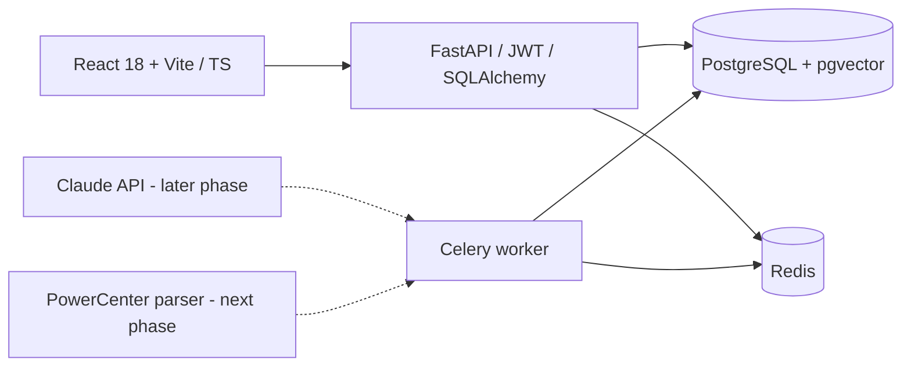

# MigraPilot — Phase 2 parser

> **Convert it. Prove it. Fix it.**
>
> AI-powered legacy ETL migration copilot. This repo is the **Phase 1 working foundation**, not a completed ETL converter.

## What works now

- Premium dark, responsive React + TypeScript UI with public landing, login/register, dashboard and project workspace.
- PostgreSQL / pgvector full initial schema, managed by Alembic.
- FastAPI async endpoints, auth with JWT and Argon2 password hashing; roles `admin`, `engineer`, `viewer` (registration is `engineer`).
- Project create/list/get/rename/delete; ownership-based isolation; real per-project mapping status dashboard (`0` when there is no data).
- Docker Compose for Postgres, Redis, FastAPI, Celery and Vite dev server.
- Anthropic-compatible structured AI adapter **only**. Not enabled in the UI and no AI conversions run in Phase 1.
- Automated API tests running against an ephemeral local SQLite database (PostgreSQL integration testing remains necessary).
- Secure PowerCenter XML/ZIP upload, Celery parse jobs, relational transformation/port lineage, and mapping retrieval.

## Run locally — Mac / Windows / Linux

Requires Docker Desktop or Docker Engine + Compose.

```bash
cp .env.example .env
# Open .env, replace BOTH POSTGRES_PASSWORD and JWT_SECRET with strong secrets.
# e.g. python3 -c 'import secrets; print(secrets.token_urlsafe(48))'
docker compose up --build
```

Open:
- Website: http://localhost:5173
- Swagger API docs: http://localhost:8000/docs
- Health: http://localhost:8000/api/v1/health

**Note:** The password is interpolated into a SQLAlchemy URL; use URL-safe credentials without `@`, `:`, `/` or `#` for this quick-start, or URL-encode them. Avoid using real production data in the demo.

If port 5432 is already occupied by local PostgreSQL, remove or remap `db.ports` in Docker Compose. Other containers can still access `db:5432`.

To stop:

```bash
docker compose down
# CAUTION: docker compose down -v deletes all local DB data
```

## API (base path: `/api/v1`)

| Method | Path | Auth | Purpose |
|---|---|---|---|
| GET | `/health` | No | Liveness check |
| POST | `/auth/register` | No | Engineer sign-up |
| POST | `/auth/login` | No | JWT login |
| GET | `/auth/me` | Yes | Current user |
| GET | `/projects` | Yes | Own projects |
| POST | `/projects` | Engineer/Admin | Create project |
| GET | `/projects/{id}` | Owner | Project metadata |
| PATCH | `/projects/{id}` | Owner + write role | Rename project |
| DELETE | `/projects/{id}` | Owner + write role | Delete project |
| GET | `/projects/{id}/dashboard` | Owner | Real mapping stats |
| POST | `/projects/{id}/uploads` | Owner + Engineer/Admin | Upload `.xml` or `.zip`; returns parse job IDs |
| GET | `/projects/{id}/mappings` | Owner | List parsed mappings |
| GET | `/mappings/{id}` | Owning project | Mapping, transformations, ports and lineage edges |
| GET | `/jobs/{id}` | Owning project | Parse status, progress and error detail |

JWT is kept in `sessionStorage` for this development prototype, not long-term production auth. Move to hardened short-lived access tokens + HttpOnly refresh sessions before deployment. Viewer/admin role provisioning and team memberships are out of scope for Phase 1.

## Run Python tests without Docker

```bash
cd api
python3 -m venv .venv
source .venv/bin/activate
pip install -r requirements.txt
python -m pytest -q
```

## Architecture



## Project structure

```text
migrapilot-starter/
├── web/                  # Vite, React, TypeScript, Tailwind
│   └── src/
│       ├── pages/        # Landing, Auth, Dashboard, ProjectWorkspace
│       ├── components/   # Sidebar shell, create-project modal
│       └── lib/          # Axios client, Zustand auth
├── api/                  # Python FastAPI API + Celery
│   ├── app/
│   │   ├── routers/      # auth, projects, parser APIs
│   │   ├── services/     # safe PowerCenter parser and persistence
│   │   ├── core/         # config, security
│   │   ├── worker/       # Celery scaffold
│   │   ├── ai_service.py # provider-agnostic JSON-schema AI calls
│   │   ├── models.py     # Phase 1 SQLAlchemy ORM models
│   │   └── schemas.py    # Pydantic request/response types
│   ├── alembic/          # full initial DDL migration
│   └── tests/            # isolated API tests
├── db/schema.sql         # reference PostgreSQL DDL (17 tables)
├── docs/                 # original prompt
└── docker-compose.yml
```

## Scope / product honesty

The parser now stores mappings, source/target definitions, supported transformations, ports, expressions and connector-level lineage. Lineage visualization, generated dbt models, actual database shadow comparisons, knowledge retrieval and AI Autopsy **are not yet implemented**. Dashboard stats remain real values queried from the database.

## Phase 2 parser behavior and limits

Uploads are validated before queueing. Defaults limit the HTTP file to 10 MiB, a ZIP to 50 files and 50 MiB uncompressed content, and reject traversal paths, symlinks, suspicious compression ratios, corrupt archives, non-XML members, DTDs and entities. Tune limits with `MAX_UPLOAD_BYTES`, `MAX_ZIP_FILES`, and `MAX_ZIP_UNCOMPRESSED_BYTES`.

The parser supports Expression, Filter, Joiner, Lookup, Aggregator, Router, Sorter and Update Strategy. Source and target definitions are returned as graph nodes. Expressions and table attributes are preserved, but the parser does not evaluate PowerCenter semantics, expand reusable objects absent from the export, execute SQL, or infer missing connector endpoints. Unsupported types are recorded in diagnostics; unresolved connectors fail safely rather than creating invented lineage.

Non-sensitive examples live in `api/tests/fixtures/`: Expression+Filter, Lookup+Aggregator and an Oracle `NVL` expression whose cross-dialect behavior must be reviewed in the later conversion phase.

## Test Phase 2 with Postman

Import `postman/MigraPilot-Phase1.postman_collection.json`, `postman/MigraPilot-Phase2-Parser.postman_collection.json`, and `postman/MigraPilot-Local.postman_environment.json`. Select **MigraPilot Local**. Run Phase 1 through **Create project** but do not run its delete request, then run the Phase 2 collection in order. If Postman cannot resolve the included relative fixture path, manually select `api/tests/fixtures/expression_filter.xml` for the `file` form-data field. Poll **Get parse job** until `status` is `completed`, then run the mapping list and detail requests.

### Next development phases

2. PowerCenter XML and ZIP validation / parsing, relational lineage, upload+job APIs. **Implemented.**
3. React Flow graph, column-level lineage and inspected transformations.
4. Real schema-validated Claude-to-dbt code conversion, Monaco editor, usage accounting, PII controls.
5. Read-only connections, shadow run comparisons and diff viewer.
6. AI Autopsy diagnosis / suggested fixes / applied revisions / reruns.
7. Knowledge base embedding retrieval (requires an embeddings provider compatible with pgvector).
8. Project chat, docs/report generation, production hardening and deployment.

**Security before production:** do not let AI-produced SQL run unreviewed with write credentials. Create isolated read-only warehouse accounts for comparisons and sandbox dbt builds. Add rate limiting, hardened session handling, tenant authorization for every nested resource, encrypted connection configs, signed asset storage, XML security, audit logs, outbound AI redaction, secure token/cost logging, and worker isolation in their implementation phases.

## Codex + Postman handoff

- **First Codex task**: open `docs/CODEX-START-HERE.md`, copy its prompt into the Codex VS Code panel, and verify Phase 1 before implementing new features.
- **Repository instructions for Codex**: `AGENTS.md`.
- **Importable Phase 1 Postman files**: `postman/MigraPilot-Phase1.postman_collection.json` and `postman/MigraPilot-Local.postman_environment.json`.
- **After verified Phase 1**: use `docs/NEXT-CURSOR-PROMPT.md` for Phase 2 (despite filename, it also works with Codex).
