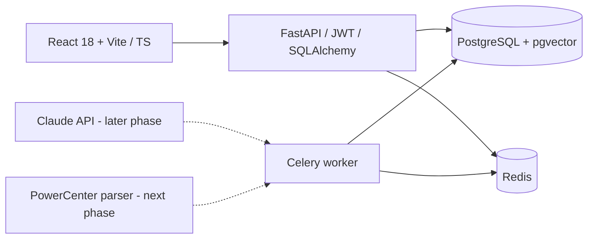

# MigraPilot — through Phase 6A AI Autopsy backend

> **Convert it. Prove it. Fix it.**
>
> AI-powered legacy ETL migration copilot. This repo is the **Phase 1 working foundation**, not a completed ETL converter.

## What works now

- Premium dark, responsive React + TypeScript UI with public landing, login/register, dashboard and project workspace.
- PostgreSQL / pgvector full initial schema, managed by Alembic.
- FastAPI async endpoints, auth with JWT and Argon2 password hashing; roles `admin`, `engineer`, `viewer` (registration is `engineer`).
- Project create/list/get/rename/delete; ownership-based isolation; real per-project mapping status dashboard (`0` when there is no data).
- Docker Compose for Postgres, Redis, FastAPI, Celery and Vite dev server.
- Anthropic-compatible structured AI adapter **only**. Not enabled in the UI and no AI conversions run in Phase 1.
- Automated API tests running against an ephemeral local SQLite database (PostgreSQL integration testing remains necessary).
- Secure PowerCenter XML/ZIP upload, Celery parse jobs, relational transformation/port lineage, and mapping retrieval.
- Interactive React Flow lineage canvas with port-level edges, Dagre layout, transformation inspector and upstream column highlighting.
- Authenticated, schema-validated PowerCenter-to-PostgreSQL/dbt conversion endpoints with immutable versions, risk analysis and AI usage accounting.

## Run locally — Mac / Windows / Linux

Requires Docker Desktop or Docker Engine + Compose.

```bash
cp .env.example .env
# Open .env, replace BOTH POSTGRES_PASSWORD and JWT_SECRET with strong secrets.
# e.g. python3 -c 'import secrets; print(secrets.token_urlsafe(48))'
docker compose up --build
```

Open:
- Website: http://localhost:5173
- Project 6 / Mapping 2 lineage: http://localhost:5173/app/projects/6/mappings/2 (sign in as the owning user)
- Swagger API docs: http://localhost:8000/docs
- Health: http://localhost:8000/api/v1/health

**Note:** The password is interpolated into a SQLAlchemy URL; use URL-safe credentials without `@`, `:`, `/` or `#` for this quick-start, or URL-encode them. Avoid using real production data in the demo.

If port 5432 is already occupied by local PostgreSQL, remove or remap `db.ports` in Docker Compose. Other containers can still access `db:5432`.

To stop:

```bash
docker compose down
# CAUTION: docker compose down -v deletes all local DB data
```

## API (base path: `/api/v1`)

| Method | Path | Auth | Purpose |
|---|---|---|---|
| GET | `/health` | No | Liveness check |
| POST | `/auth/register` | No | Engineer sign-up |
| POST | `/auth/login` | No | JWT login |
| GET | `/auth/me` | Yes | Current user |
| GET | `/projects` | Yes | Own projects |
| POST | `/projects` | Engineer/Admin | Create project |
| GET | `/projects/{id}` | Owner | Project metadata |
| PATCH | `/projects/{id}` | Owner + write role | Rename project |
| DELETE | `/projects/{id}` | Owner + write role | Delete project |
| GET | `/projects/{id}/dashboard` | Owner | Real mapping stats |
| POST | `/projects/{id}/uploads` | Owner + Engineer/Admin | Upload `.xml` or `.zip`; returns parse job IDs |
| GET | `/projects/{id}/mappings` | Owner | List parsed mappings |
| GET | `/mappings/{id}` | Owning project | Mapping, transformations, ports and lineage edges |
| GET | `/jobs/{id}` | Owning project | Parse status, progress and error detail |
| POST | `/mappings/{id}/convert` | Owner + Engineer/Admin | Generate and persist the next reviewed dbt conversion version |
| POST | `/conversions/{id}/regenerate` | Owner + Engineer/Admin | Create a new version from a prior conversion and user comment |
| GET | `/mappings/{id}/conversions` | Owning project | List immutable conversion versions, newest first |
| GET | `/conversions/{id}` | Owning project | Retrieve generated SQL, schema YAML and conversion metadata |
| POST | `/conversions/{id}/shadow-runs` | Owner + Engineer/Admin | Queue an isolated synthetic-data comparison |
| GET | `/shadow-runs/{id}` | Owner | Poll status and retrieve the bounded comparison report |
| GET | `/conversions/{id}/shadow-runs` | Owning project | List prior shadow runs newest first |
| POST | `/shadow-runs/{id}/autopsies` | Owner + Engineer/Admin | Queue a diagnosis for a genuine FAIL or sanitized execution failure |
| GET | `/autopsies/{id}` | Owner | Poll a persisted structured diagnosis |
| GET | `/shadow-runs/{id}/autopsies` | Owner | List immutable diagnosis history newest first |

JWT is kept in `sessionStorage` for this development prototype, not long-term production auth. Move to hardened short-lived access tokens + HttpOnly refresh sessions before deployment. Viewer/admin role provisioning and team memberships are out of scope for Phase 1.

## Run Python tests without Docker

```bash
cd api
python3 -m venv .venv
source .venv/bin/activate
pip install -r requirements.txt
python -m pytest -q
```

## Architecture



## Project structure

```text
migrapilot-starter/
├── web/                  # Vite, React, TypeScript, Tailwind
│   └── src/
│       ├── pages/        # Landing, Auth, Dashboard, ProjectWorkspace
│       ├── components/   # Sidebar shell, create-project modal
│       └── lib/          # Axios client, Zustand auth
├── api/                  # Python FastAPI API + Celery
│   ├── app/
│   │   ├── routers/      # auth, projects, parser APIs
│   │   ├── services/     # safe PowerCenter parser and persistence
│   │   ├── core/         # config, security
│   │   ├── worker/       # Celery scaffold
│   │   ├── ai_service.py # provider-agnostic JSON-schema AI calls
│   │   ├── models.py     # Phase 1 SQLAlchemy ORM models
│   │   └── schemas.py    # Pydantic request/response types
│   ├── alembic/          # full initial DDL migration
│   └── tests/            # isolated API tests
├── db/schema.sql         # reference PostgreSQL DDL (17 tables)
├── docs/                 # original prompt
└── docker-compose.yml
```

## Scope / product honesty

The parser stores mappings, source/target definitions, supported transformations, ports, expressions and connector-level lineage. The authenticated project workspace renders those records with React Flow; it does not invent graph nodes or edges. Phase 4 generates review-only dbt SQL and schema documentation. Phase 5 compares that SQL against its controlled synthetic fixture in an isolated shadow database and displays persisted reports in the conversion workspace. Phase 6A can diagnose genuine persisted failures with bounded metadata-only evidence. External warehouse connections, production-row comparisons, automatic repair and the Autopsy frontend are not implemented.

## Phase 3 lineage UI

Open `/app/projects/{project_id}` to select a parsed mapping, or deep-link to `/app/projects/{project_id}/mappings/{mapping_id}`. The canvas automatically lays out source, transformation and target nodes from left to right. Click a node for its port expressions, table attributes and diagnostics. Click any port—especially a target port—to highlight every connector and port reachable upstream. React Flow controls provide zoom, pan, fit-view and a minimap.

## Phase 4A conversion backend

Gemini is the default development provider. Set `GEMINI_API_KEY` in `.env`, leave `AI_PROVIDER=gemini`, and restart the API before using conversion endpoints. The default `GEMINI_MODEL` is `gemini-3.8-flash`. Anthropic remains available by setting `AI_PROVIDER=anthropic` and `ANTHROPIC_API_KEY`. Shared optional settings are `AI_MAX_OUTPUT_TOKENS` (default `4096`), `AI_CONVERSION_RATE_LIMIT_PER_MINUTE` (default `5`), `AI_PROVIDER_TIMEOUT_SECONDS` (default `60`) and `AI_PROVIDER_MAX_RETRIES` (default `1`). Gemini retries are limited to transient transport, timeout and 408/5xx failures. Provider credentials remain server-side and are never returned by the API or placed in Postman.

Conversion sends mapping metadata only: transformation names/types/order, ports, expressions, transformation metadata and connector endpoints. It does not send raw XML, warehouse rows, passwords or connection configuration. The selected provider must return a Pydantic-validated structure containing read-only dbt SQL, `schema.yml`, confidence reasons and risk flags. Gemini uses the Interactions API and JSON structured output through `google-genai` 2.x with provider-side request storage disabled. Its provider schema intentionally contains structural fields only to stay within Gemini's schema-complexity limit; the complete Pydantic constraints and SQL safety checks are always applied locally before persistence. Provider failures log only stage, exception class, status, elapsed time and request ID. Local checks add risks for Oracle functions, NULL/empty-string semantics, implicit casts and unsupported transformations. Every successful call records input/output token counts in `ai_usage` and inserts a new `(mapping_id, version)` row; prior versions are never overwritten. Generated SQL is stored for human review and is never executed.

The built-in rate limiter is process-local and suitable for the current single API container. A multi-replica production deployment should replace it with a shared Redis-backed limit.

### Phase 4A Postman

Import `postman/MigraPilot-Phase4A-Conversion.postman_collection.json` and the updated local environment. Sign in as the owner of a project containing a parsed mapping, set `mapping_id`, then run **Convert mapping** followed by **Regenerate conversion**. The collection saves `conversion_id`. Without a real provider credential the expected result is `503`; automated tests use a mock provider and need no paid API key.

For the verified local example, set `project_id=6` and `mapping_id=2` in **MigraPilot Local**, then obtain `token` by running the Phase 1 login request with the owner account for Project 6. Keep `GEMINI_API_KEY` only in the server `.env`; restart with `docker compose up -d --build api worker`. Run **Convert mapping** (no body), then **Regenerate conversion** (the included JSON body contains only a review instruction). A successful response is `201`, reports `model_used`, SQL, schema YAML, confidence and risks, and creates a new immutable version each time.

## Phase 4B conversion workspace

Open `/app/projects/{project_id}/mappings/{mapping_id}` to use the responsive lineage and SQL workspace. The desktop divider resizes the graph and editor; smaller screens use Lineage and SQL conversion tabs. Monaco is lazy-loaded and provides editable SQL, read-only schema YAML and version diffs. SQL edits are local browser drafts only: they are never sent to PostgreSQL and cannot overwrite immutable AI versions. Generate and Regenerate explicitly create new versions through the authenticated Phase 4A endpoints; the browser does not retry those writes automatically.

## Phase 5A shadow runs

Shadow runs execute an immutable conversion only in the separate `shadow-db` container. The worker creates a unique schema per run, loads the versioned `orders_discount_v1` fixture with the loader account, compiles only the allowlisted `{{ source('raw', 'src_orders') }}` reference, validates one read-only PostgreSQL query with sqlglot, and executes it through a connection-limited read-only role. Transactions have statement/lock/idle timeouts, results and mismatch samples are bounded, and the schema is removed after the run. The shadow database has no host port and contains no application tables.

Start the complete stack with `docker compose up -d --build`. Set separate `SHADOW_LOADER_PASSWORD` and `SHADOW_EXECUTOR_PASSWORD` values before first initialization. Changing them after the shadow volume is initialized requires deliberate credential rotation inside that isolated database; do not delete the application database volume. Phase 5A supports only the deterministic Mapping 2 fixture and does not execute arbitrary Jinja/dbt macros.

## Phase 5B validation workspace

Open a mapping conversion and select **Validation** beside **Code & review**. The workspace lists saved-version shadow runs, polls queued/running reports every three seconds, and stops at completed or failed. PASS, comparison FAIL and execution failure are visually distinct. The dashboard renders only persisted API metrics and bounded mismatch samples. Starting validation always uses the selected immutable conversion; an unsaved Monaco draft is clearly excluded.

## Phase 6A AI Autopsy backend

AI Autopsy accepts only completed comparison `FAIL` runs or failed shadow executions with a sanitized error category. The authenticated API persists a queued record and a Celery worker builds bounded evidence from immutable conversion SQL, PowerCenter transformations/ports/expressions, connector lineage and aggregate mismatch metrics. Raw mismatch values, keys, credentials, connection strings, JWTs and provider secrets are excluded. Gemini/Anthropic structured output uses the existing provider adapter and reduced Gemini-side schema; Pydantic, evidence-reference checks and read-only suggested-SQL checks remain authoritative locally.

Autopsy output is advisory. Suggested SQL is marked unverified, is never executed, never overwrites a conversion, and never creates a replacement version. Provider failures are stored only as safe categories. Configure `AI_AUTOPSY_RATE_LIMIT_PER_MINUTE` and the `AUTOPSY_MAX_*` evidence bounds through server environment variables.

Autopsy provider work has a total wall-clock budget (`AI_AUTOPSY_REQUEST_BUDGET_SECONDS`, default 45), independent of the provider SDK's per-attempt timeout. The Celery soft/hard limits default to 60/70 seconds, leaving bounded time for validation, provider-client closure, terminal-state persistence and connection cleanup. The SDK may retry configured transient HTTP failures only inside that total budget. Soft task timeouts are caught and persisted as `task_soft_timeout` using a fresh transaction.

Running records older than `AI_AUTOPSY_STALE_AFTER_SECONDS` (default 300) can be recovered only with the explicit guarded command below. It first requires successful responses from Celery's active, reserved and scheduled inspections, and refuses to recover a task that is live or not yet stale:

```bash
docker compose exec worker python -m app.cli.recover_stale_autopsies \
  --autopsy-id AUTOPSY_ID --reason worker_interrupted_stale \
  --confirm-stale-recovery
```

For a genuine deterministic FAIL demonstration, run this explicitly after starting the full stack (replace the email with an existing local owner):

```bash
docker compose exec worker python -m app.cli.seed_phase6a_fail_demo \
  --owner-email test@migrapilot.dev --confirm-development-only
```

The command creates/reuses a separate project named **Phase 6A AI Autopsy FAIL Demo**, creates an intentionally wrong `0.80` conversion against a `0.90` reference, and executes it only in `shadow-db`. It prints the new IDs. It is never run at application startup and does not alter Project 6, Mapping 2, conversions 1/2, or existing PASS runs.

## Phase 2 parser behavior and limits

Uploads are validated before queueing. Defaults limit the HTTP file to 10 MiB, a ZIP to 50 files and 50 MiB uncompressed content, and reject traversal paths, symlinks, suspicious compression ratios, corrupt archives, non-XML members, DTDs and entities. Tune limits with `MAX_UPLOAD_BYTES`, `MAX_ZIP_FILES`, and `MAX_ZIP_UNCOMPRESSED_BYTES`.

The parser supports Expression, Filter, Joiner, Lookup, Aggregator, Router, Sorter and Update Strategy. Source and target definitions are returned as graph nodes. Expressions and table attributes are preserved, but the parser does not evaluate PowerCenter semantics, expand reusable objects absent from the export, execute SQL, or infer missing connector endpoints. Unsupported types are recorded in diagnostics; unresolved connectors fail safely rather than creating invented lineage.

Non-sensitive examples live in `api/tests/fixtures/`: Expression+Filter, Lookup+Aggregator and an Oracle `NVL` expression whose cross-dialect behavior must be reviewed in the later conversion phase.

## Test Phase 2 with Postman

Import `postman/MigraPilot-Phase1.postman_collection.json`, `postman/MigraPilot-Phase2-Parser.postman_collection.json`, and `postman/MigraPilot-Local.postman_environment.json`. Select **MigraPilot Local**. Run Phase 1 through **Create project** but do not run its delete request, then run the Phase 2 collection in order. If Postman cannot resolve the included relative fixture path, manually select `api/tests/fixtures/expression_filter.xml` for the `file` form-data field. Poll **Get parse job** until `status` is `completed`, then run the mapping list and detail requests.

### Next development phases

2. PowerCenter XML and ZIP validation / parsing, relational lineage, upload+job APIs. **Implemented.**
3. React Flow graph, column-level lineage and inspected transformations. **Implemented.**
4. Real schema-validated provider-to-dbt code conversion, Monaco editor, usage accounting, PII controls. **Backend conversion implemented with Gemini and Anthropic providers; frontend editor remains pending.**
5. Read-only connections, shadow run comparisons and diff viewer.
6. AI Autopsy diagnosis backend and suggested fixes. **Backend diagnosis implemented; apply-fix loop/frontend deferred.**
7. Knowledge base embedding retrieval (requires an embeddings provider compatible with pgvector).
8. Project chat, docs/report generation, production hardening and deployment.

**Security before production:** do not let AI-produced SQL run unreviewed with write credentials. Create isolated read-only warehouse accounts for comparisons and sandbox dbt builds. Add rate limiting, hardened session handling, tenant authorization for every nested resource, encrypted connection configs, signed asset storage, XML security, audit logs, outbound AI redaction, secure token/cost logging, and worker isolation in their implementation phases.

## Codex + Postman handoff

- **First Codex task**: open `docs/CODEX-START-HERE.md`, copy its prompt into the Codex VS Code panel, and verify Phase 1 before implementing new features.
- **Repository instructions for Codex**: `AGENTS.md`.
- **Importable Phase 1 Postman files**: `postman/MigraPilot-Phase1.postman_collection.json` and `postman/MigraPilot-Local.postman_environment.json`.
- **After verified Phase 1**: use `docs/NEXT-CURSOR-PROMPT.md` for Phase 2 (despite filename, it also works with Codex).
